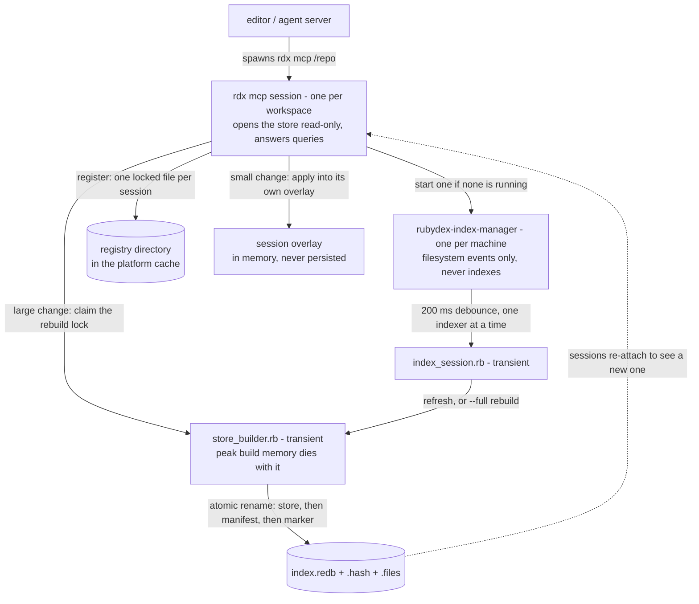

# Disk-persisted index

Rubydex normally builds its whole index in the heap of the process that asks for it. On a large
workspace that is hundreds of megabytes per process: on a 27,674-file corpus, 692 MB resident. The
disk-persisted index keeps that bulk index in a [redb](https://github.com/cberner/redb) store on disk
instead, opens it read-only, and holds in memory only the small set of nodes a live edit touches. The
same session drops to 73 MB, and a bare open costs about 5 MB.

It is opt-in per workspace, and it is a cache: the store is always rebuildable from your source files,
and deleting it is always safe.

## When you would want it

The disk index pays off on a larger codebase, and it pays off most when more than one process wants the
same index:

- A small fraction of the memory: 73 MB against 692 MB for the same 27,674-file corpus, and about 5 MB
  for a session that only opens the store.
- Starting is fast after the first build, because the work is already done — re-attaching to a store is
  ~71 ms where building that index from scratch is tens of seconds (24.6 s on a 6,441-file workspace).
  The first build is the slow one: it indexes everything and then writes the store.
- Updates are usually incremental: a handful of changed files is applied in milliseconds. A large change
  — a branch switch, a quarter of the workspace — rebuilds the store, once, for everyone.
- Several sessions on one directory share one store and one rebuild, instead of each holding its own
  copy of the index and each computing it.

It is not faster everywhere. Reading from disk costs more than reading from the heap, and name search
is markedly slower than the in-memory path (~100 ms/op against ~0.05 ms/op) until the store grows a
name-keyed index. Point lookups — hover, ancestors, references — are the ones that stay sub-millisecond
(~0.09 ms/op).

## Enabling it

Commit a `rubydex.toml` with a `[disk_index]` section:

```toml
[disk_index]
enabled = true          # keep the bulk index in a redb store instead of the heap
location = "tmp"        # "tmp" (the workspace's tmp/), "global" (the platform cache), or an absolute dir
manager = true          # let the machine-wide background manager keep the store fresh
```

| Variable | Effect |
| --- | --- |
| `RUBYDEX_DISK_INDEX=0` | Use the in-memory path for this run, ignoring the config. |
| `RUBYDEX_CACHE_DIR=/path` | Put stores under a directory you choose. |
| `RUBYDEX_INDEX_MANAGER=0` | Never start or register with the background manager. |
| `RUBYDEX_REFRESH_TTL=0` | Re-check the filesystem before every call instead of reusing the last check. |

Where the store goes: `RUBYDEX_CACHE_DIR` wins, then `location`, then the workspace's own `tmp/` when
one exists (the Rails convention, and the right home for a worktree workflow, where every checkout is
a different workspace), then the platform cache. A store kept outside the workspace is named
`<workspace>-<hash8>` so `du` on the cache root reads as the projects it belongs to. When rubydex
writes a store inside your repo it adds the directory to `.git/info/exclude`, so it cannot be
`git add -A`'d by accident — and it is never something you should commit.

## What lands on disk

| File | What it is |
| --- | --- |
| `index.redb` | The index itself. Read-only to every session; rebuilt, never patched. |
| `index.redb.hash` | Signature of the source state the store was built from. |
| `index.redb.files` | Manifest: every file in the store with its mtime and size. |
| `index.redb.corrupt` | A store that reported read failures, moved out of the way (see Troubleshooting). |
| `index.redb.rebuild/` | Create-exclusive lock directory: N stale sessions pay one rebuild. |

## How a session keeps up with your edits

At boot a session builds the store if it is missing or stale, then opens it. After that, before every
query it asks "has anything changed?" with two signals, cheap one first:

- **The commit under the workspace** (`git rev-parse HEAD`, ~1.3 ms). Catches commits, branch switches
  and stashes — the changes that rewrite many files at once — without touching a single file.
- **A walk of the workspace** (stat every indexable file; ~105 ms on 6,441 files). Reused for 2 seconds
  at a time, so a burst of queries pays for it once. It never runs on a timer: no query, no walk.

What that means in practice: edits saved through your editor are visible immediately (the editor
indexes what it saves), a branch switch is visible on the next call, and an edit made by `sed` or a
formatter outside the editor can be answered up to two seconds late. Set `RUBYDEX_REFRESH_TTL=0` if you
want that window closed.

When something did change, the size of the change picks the remedy. A small diff is applied into the
session's own overlay in milliseconds (200 files: ~71 ms). A large diff — or one that would leave the
overlay holding more than a quarter of the workspace — triggers a rebuild in a short-lived child
process, whose memory is reclaimed when it exits, and every session in the directory moves to the new
store. Rebuilding is what keeps a long-lived server from quietly accumulating the whole index in memory
again (~12 MB per 1,000 edited files).

### Building the store

The build happens in a fresh child process that the session spawns and waits for. Never `fork`: the
parent is long-lived, with a warm allocator and live threads, and a forked child that then allocates
heavily corrupts its allocator — a fresh process starts with a clean heap. So the peak memory of a
build belongs to a process that no longer exists, and the parent never sees it. (Waiting for the child
is what stops it becoming a zombie; the memory isolation comes from it being a separate process at all.)

The result is published by atomic rename — store first, then the manifest, then the freshness marker —
so a session that looks mid-build sees the previous store, never a half-written one.

## What spawns what



Nothing here is a service a session depends on. The store is a file; the manager and the two transient
processes are optimizations. Every arrow into them can be cut and the session still answers the same
questions — only more slowly on the next call.

## The background manager (optional)

`rubydex-index-manager` is a small Rust process, one per machine, that watches the workspaces with a
live session and keeps their stores fresh while nobody is asking. It is the only process that
subscribes to filesystem events; it debounces 200 ms of events into one indexer, runs one indexer at a
time, and spawns it as a child so build memory dies with it. A burst covering a quarter of the
workspace rebuilds from scratch. It exits when no session is alive.

It is a head start, never a dependency: with it absent, killed, or never started, sessions still
refresh exactly as described above. Liveness is an OS lock rather than a PID — a session holds its
registry file under an exclusive lock for its whole lifetime, so the manager learns a session died the
moment the OS released that lock, however it died. Measured with three idle sessions: 3.4 MB resident,
0.2% CPU; a 200-file branch-switch storm reaches a fresh store marker 9 s later.

## Costs

On a 6,441-file workspace: first build ~25 s (once, then only when the source state genuinely changes
or the layout version moves), re-attaching to a store someone else built ~71 ms, a 200-file surgical
refresh ~71 ms. Cold builds happen in a child process, so the peak belongs to the child and is returned
to the operating system when it exits.

## Troubleshooting

**Answers look stale.** Force a fresh look: `RUBYDEX_REFRESH_TTL=0 bundle exec rdx ...`. If it clears
up, the 2-second window was the cause and you can leave it at 0 for that process.

**You suspect the store is wrong or you just upgraded.** Delete it. `rm -rf <store dir>` — the next
session rebuilds. Nothing else needs to be reset.

**An `index.redb.corrupt` appeared.** A read from the store failed (a bad disk, a truncated file, an
incompatible layout from a development build). Rubydex warns, moves the store aside, detaches it and
indexes in memory, so you keep working. The next run rebuilds. If it happens on every run after an
upgrade, that is a bug — open an issue with the warning line.

**Two editors and an agent server on one directory.** They share one store. The first one to notice a
change claims the rebuild lock and builds; the others re-attach to the result. One rebuild, not three.

**You want the memory back but not the disk path.** `RUBYDEX_DISK_INDEX=0` for one run, or
`enabled = false` in the config.

## Limits

- Live edits live in the session's memory and are never written back to the store. Another session sees
  them only once the store is rebuilt from disk.
- Out-of-band edits can be answered up to `RUBYDEX_REFRESH_TTL` late (2 s by default).
- The store is a local, rebuildable cache: not shareable between machines, not worth committing, and
  safe to delete at any moment.

## Internals

- `docs/disk-persisted-index/memory-baseline.md` — the measurement log (resident memory and timings by
  corpus and stage) that the performance comments in the code quote. Reproduce with
  `utils/session_profile.rb` and the `bench_build_write_vs_drop` test.
- `docs/disk-persisted-index/fs-event-crate.md` — the decision record for the file-system event crate
  the manager uses.
